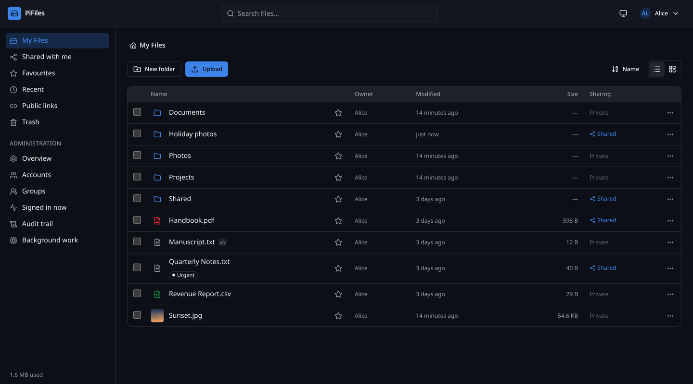
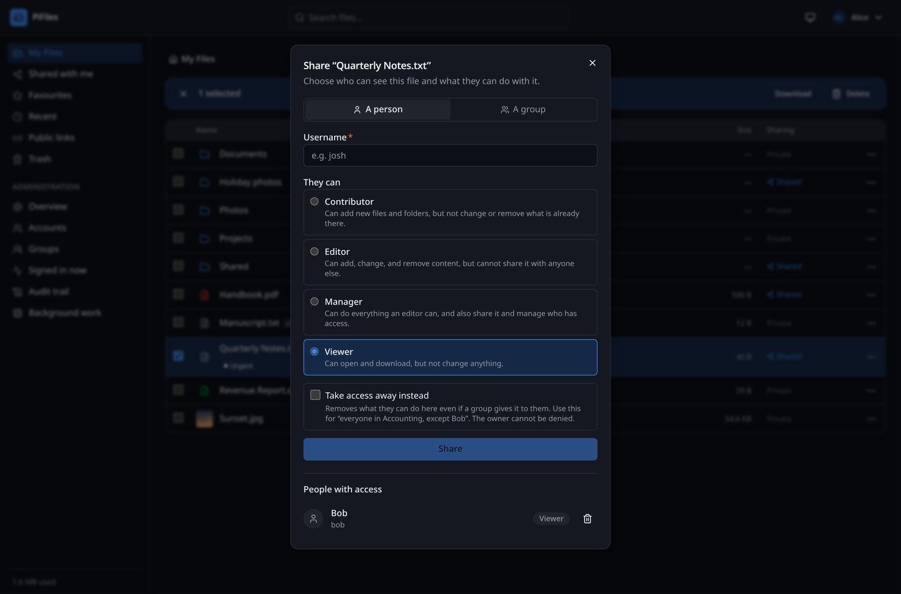
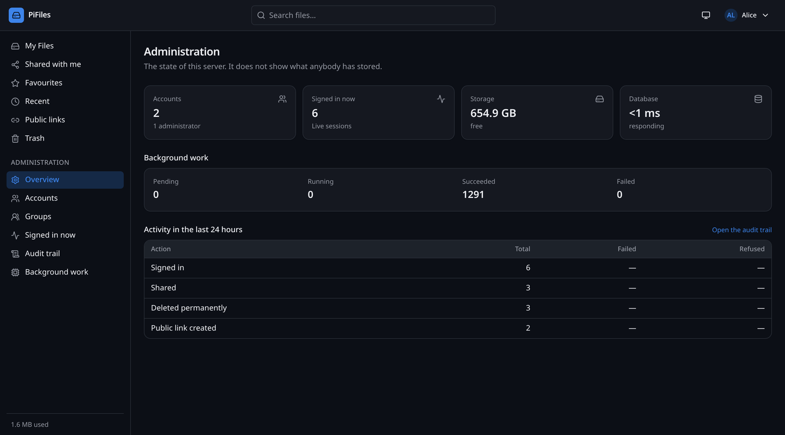
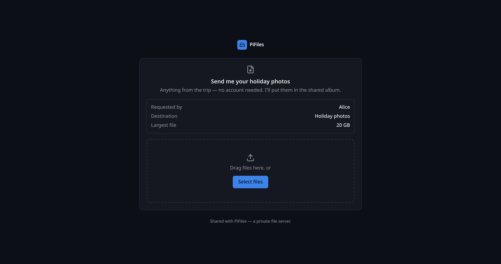

# PiFiles

[](https://github.com/joshuanmoses/piCloud/actions/workflows/ci.yml)
[](LICENSE)
[](backend/go.mod)
[](#requirements)

A private, self-hosted file server for your own hardware — the file-management
half of Nextcloud or Dropbox, built to run comfortably on a Raspberry Pi.

Sign in from a browser, upload and organise files, share them with people you
choose, and keep every byte on a drive you own.

> **Status: all 12 planned phases complete.** PiFiles is feature-complete: sign in,
> browse, upload by drag-and-drop, download, organise, share with people and
> groups, publish links for people who have no account, collect files through an
> upload portal, search, star, tag, preview, download whole folders as a ZIP,
> keep and restore file versions, and administer accounts against a queryable
> audit trail — all through the browser, verified end to end with 862 tests,
> with API rate limiting and optional malware scanning in front of it, and a
> backup that refuses to report success unless every step of it succeeded.
>
> **It has not yet been run on a Raspberry Pi.** The ARM64 binary and image
> build and start under emulation, and the memory behaviour is verified under
> Pi-sized caps, but nobody has booted a real board with it. Treat throughput
> figures as estimates.
>
> [docs/BUILD_STATUS.md](docs/BUILD_STATUS.md) records exactly what works
> today, what does not, and what is left.

---

## Why PiFiles

Most self-hosted file servers assume a real server. PiFiles assumes a £60
computer with 4 GB of RAM and a USB drive, and is built around that constraint:

- **One small Go binary.** No Kubernetes, no Redis, no Elasticsearch, no JVM.
  PostgreSQL doubles as the metadata store, the search index, and the job queue.
- **Streams, never buffers.** A 20 GB upload uses no more memory than a 20 KB
  one, so a 4 GB board never runs out.
- **Installable by a non-expert.** One command, generated secrets, preflight
  checks that explain problems in plain language instead of failing obscurely.
- **Secure by construction.** Files on disk are named by the hash of their
  contents, so no user-supplied text ever reaches a filesystem path — path
  traversal, Unicode normalisation, and reserved-name bugs are designed out
  rather than filtered for.
- **Administrators cannot read your files.** They manage accounts, quotas, and
  the server. Access to content comes from ownership or a share, and from
  nothing else — including for the person who installed it.
- **Honest about its limits.** [docs/security.md](docs/security.md) lists what
  PiFiles does *not* defend against, and
  [docs/BUILD_STATUS.md](docs/BUILD_STATUS.md) lists what has not been verified.

## Screenshots

Captured from a running instance. PiFiles follows the browser's light or dark
setting; these are the dark theme.

| | |
|---|---|
|  |  |
| **Your files.** Folders and files together, with what each one is shared with. | **Sharing.** Four roles, explained in words rather than permission bits. |
|  |  |
| **Administration.** The state of the server — and nothing about what people have stored. | **Collecting files.** A link that lets somebody with no account send you files. |

## First run

After `make up`, open the printed URL and create the first administrator. There
is no default password and nothing ships with credentials.

To create it from the command line instead — which is what a scripted install
would do:

```sh
make create-admin
```

> Complete setup before connecting the machine to an untrusted network. Until an
> administrator exists, whoever reaches the server can claim it. The server logs
> a warning on every start until that is done.

## Architecture

```text
   Browser ──TLS──▶ Caddy ──HTTP──▶ PiFiles ──▶ PostgreSQL   (metadata)
                                        └─────▶ USB SSD/NVMe (file content)
```

One application container serves the REST API, the compiled web interface, and
the background job runner. Caddy handles TLS and security headers. PostgreSQL
holds metadata; file *contents* live on the filesystem, addressed by SHA-256
digest — never as database blobs.

Full detail: [docs/architecture.md](docs/architecture.md).

**Stack** — Go 1.25 · React 19 · TypeScript · Vite · Tailwind CSS v4 ·
PostgreSQL 17 · Caddy 2 · Docker Compose

## Requirements

|  | Minimum | Recommended |
| --- | --- | --- |
| Board | Raspberry Pi 4 | Raspberry Pi 5 |
| RAM | 4 GB | 8 GB |
| OS | Raspberry Pi OS Lite **64-bit**, Debian, or Ubuntu (ARM64) | same |
| Storage | External USB SSD or HDD | NVMe or SATA SSD |
| Software | Docker with the Compose plugin | same |

Also runs on Linux x86_64. **32-bit ARM is not supported** — use the 64-bit OS
image.

> Do not put user files on the microSD card. Sustained writes wear it out, and
> losing the boot media would take every user's files with it.

## Quick start

```sh
git clone https://github.com/joshuanmoses/piCloud.git
cd piCloud

make install
```

The installer checks the machine, asks where files should live and how people
will reach it, generates strong secrets, and starts everything. It never
formats a disk, never overwrites an existing configuration, and is safe to run
again.

<details>
<summary>Or set it up by hand</summary>

```sh
./scripts/generate-secrets.sh   # creates .env with strong random secrets
nano .env                       # set STORAGE_ROOT and APP_URL

make up                         # preflight checks, build, and start
```

</details>

`make up` prints the URL when everything is healthy. To see it again:

```sh
make url
make health
```

## Raspberry Pi installation

The short version:

```sh
# 1. Mount your external drive so it survives a reboot — see docs/storage.md
sudo mkdir -p /srv/pifiles

# 2. Install Docker if you do not have it
curl -fsSL https://get.docker.com | sh
sudo usermod -aG docker $USER      # then log out and back in

# 3. Set up and start PiFiles
./scripts/generate-secrets.sh
make up
```

`scripts/preflight.sh` runs automatically and will tell you — in plain
language, with the exact command to fix it — if the drive is not mounted, the
permissions are wrong, a port is taken, or user files would land on the SD card.

Step-by-step guide: [docs/raspberry-pi.md](docs/raspberry-pi.md).

## Development

```sh
make dev          # PostgreSQL + Go backend + Vite, all with hot reload
make check        # everything CI runs: lint, typecheck, tests
make test         # unit tests, both halves
make test-integration   # tests that need a real PostgreSQL
make db-check     # verify the database and filesystem agree
make help         # every available command
```

The backend serves the API on `:8080`; the Vite dev server runs on `:5173` and
proxies `/api` to it, so cookies and CSRF behave exactly as they do in
production. Details: [docs/development.md](docs/development.md).

## Production deployment

```sh
docker compose -f docker-compose.yml -f docker-compose.prod.yml up -d
# or simply:
make up-prod
```

The production overlay adds memory limits sized for a 4 GB board, `restart:
always`, dropped Linux capabilities, and read-only root filesystems.

For automatic HTTPS, point a DNS record at the machine and set
`CADDY_SITE_ADDRESS=files.example.com` in `.env`. Caddy obtains and renews the
certificate on its own.

To start PiFiles at boot, install the systemd unit in `deploy/systemd/`.

## Backup

```sh
make backup                                    # database, content, and configuration
make backup-verify BACKUP=/path/to/backup      # confirm it is intact
make restore BACKUP=/path/to/backup            # put it back
```

The backup script **never reports success unless every step succeeded**. It
reads back the database dump and the content archive to confirm they parse, and
deletes its own output if anything fails — so nothing is ever left behind that
could be mistaken for a usable backup.

Backups contain your secret key. Keep them private, and copy them off the
machine: a backup on the same disk as the original protects against mistakes,
not against the disk failing.

**Rehearse the restore before you need it.**
[docs/backup-restore.md](docs/backup-restore.md) explains how to do that against
a scratch instance rather than your real one — it takes fifteen minutes and it
is the difference between a backup and a hope.

## Upgrading

```sh
git pull
make upgrade     # backs up, builds, restarts, and verifies
```

`git pull` first: the upgrade builds from the source that is checked out. It
then takes a backup and **refuses to proceed if the backup fails** — migrations
are forward-only, so that backup is the only way back.

Migrations run at startup under a database lock, so concurrent restarts are
safe. The server refuses to start if a previously applied migration has been
edited, or if the binary is older than the database schema — both are
protections against a half-upgraded instance.

## Documentation

| | |
| --- | --- |
| [architecture.md](docs/architecture.md) | How the system is put together and why |
| [authentication.md](docs/authentication.md) | Passwords, sessions, CSRF, lockout |
| [authorization.md](docs/authorization.md) | Who may do what, and how it is enforced |
| [sharing.md](docs/sharing.md) | Roles, inheritance, groups, and their limits |
| [security.md](docs/security.md) | The threat model, what is defended, and what is not |
| [backup-restore.md](docs/backup-restore.md) | Taking backups, and rehearsing a restore before you need it |
| [BUILD_STATUS.md](docs/BUILD_STATUS.md) | What works today, defects, deferred work |
| [installation.md](docs/installation.md) | Installing on any supported Linux |
| [raspberry-pi.md](docs/raspberry-pi.md) | Pi-specific setup and tuning |
| [storage.md](docs/storage.md) | Mounting external drives, layout, permissions |
| [api.md](docs/api.md) | REST API reference |
| [development.md](docs/development.md) | Working on PiFiles |
| [troubleshooting.md](docs/troubleshooting.md) | When something goes wrong |

And at the top level:

| | |
| --- | --- |
| [CONTRIBUTING.md](CONTRIBUTING.md) | How to build, test, and send a change |
| [SECURITY.md](SECURITY.md) | Reporting a vulnerability, and what is in scope |
| [CHANGELOG.md](CHANGELOG.md) | What changed, and when |

## Contributing

Issues and pull requests are welcome. [CONTRIBUTING.md](CONTRIBUTING.md)
covers the setup, the checks that have to pass, and the handful of conventions
the code follows — the most important being that every permission check happens
on the server, and that security properties get named tests rather than
incidental coverage.

Found a security problem? Please report it privately rather than as a public
issue — see [SECURITY.md](SECURITY.md).

## Licence

MIT — see [LICENSE](LICENSE).
